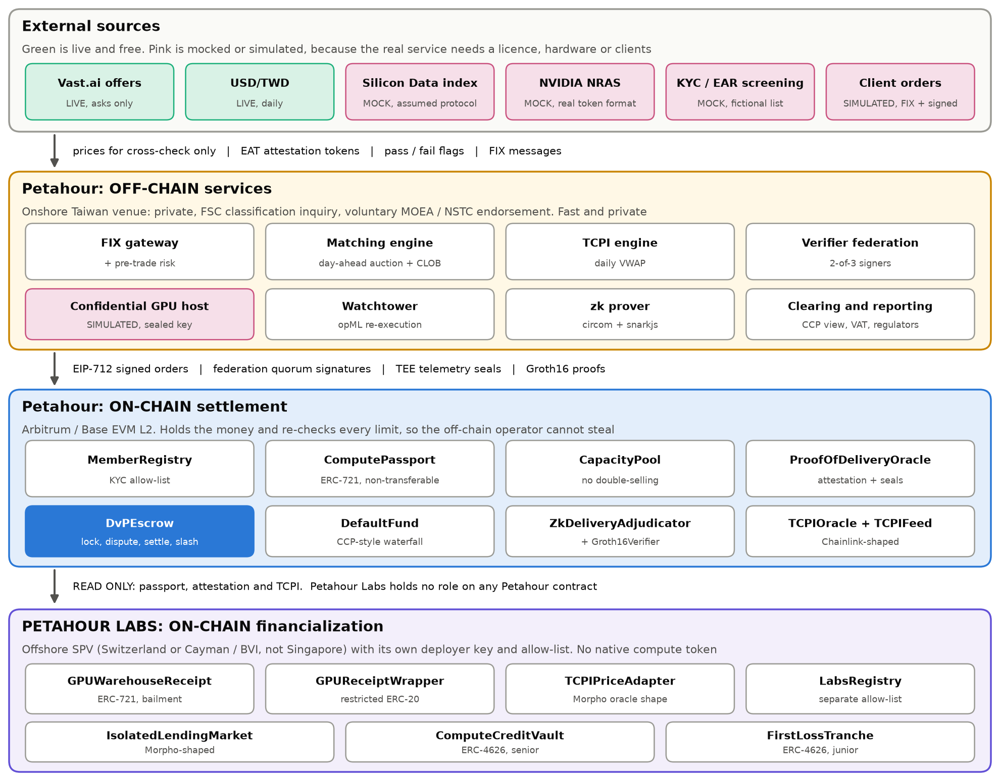
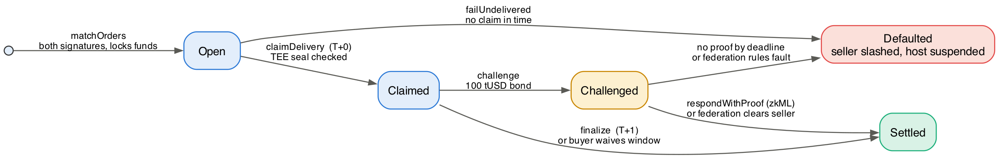
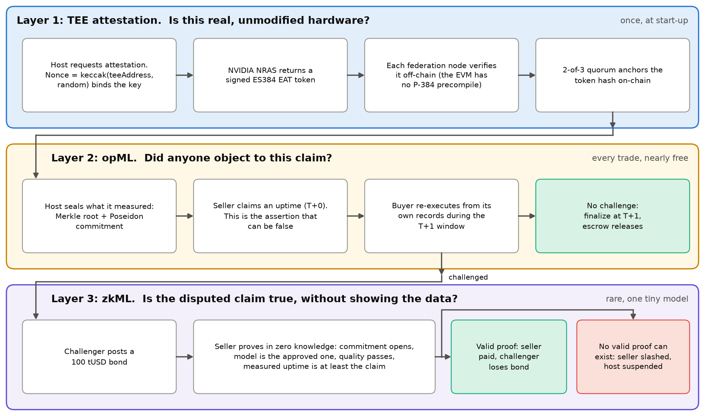

# Petahour On-Chain PoC: End-to-End Design

| | |
|---|---|
| **Scope** | Proof of concept of the Petahour on-chain architecture: Petahour Labs, Oracle and Proof-of-Delivery, zkML, Arbitrum/Base, and on-chain/off-chain integration |
| **Sources** | *Petahour: Market Research, Architecture & Roadmap* (3 Nov 2026), the 5 Nov venue evaluation, and the wider Petahour research folder (section 2) |
| **Status** | Built and tested on a local chain and on forks of live testnets. Not deployed to a public network. Simulated value only |
| **Date** | 6 November 2026 |

*The research calls this venture the Taiwan Compute Exchange, or TCX. It is now Petahour, a name tied to no single country and no single chip. Taiwan is its first market, not its limit. See section 3.1b.*

## 1. Summary

This PoC implements the four-layer architecture in report Figure 4.3 as working software: asset registration, off-chain price discovery, on-chain settlement with proof-of-delivery, and the Petahour Labs composability layer. It runs end to end on a real EVM, including forks of live Arbitrum Sepolia and Base Sepolia.

The central result is that the mechanisms fit together. A GPU-hour moves from a federation-approved passport, through a signed order and a uniform-price auction, into DvP escrow, through sealed delivery and a T+1 window, and out as an auditable TCPI print that prices a lending market. Each step is enforced by a contract or by cryptography.

The work also produced findings that matter more than the code. Section 3 lists report statements that the 5 November evaluation supersedes, and design issues the report does not address. Read that section before presenting this architecture to anyone.

## 2. What was reviewed

| Source | Date | How it was used |
|---|---|---|
| `2026-11-03_..._Research.pdf` | 3 Nov | Primary requirements, including Figures 4.2, 4.3 and 5.1, read as images |
| `TW-SG eval_Claude.pdf` (scanned, read by OCR) | 5 Nov | **Newest source. Overrides the report where they conflict** |
| `C3_..._PoC_Architecture` | Oct | Origin of the PoC architecture; volume-triggered sunset rule; Petahour Labs rationale |
| `C2_TCX_B200_..._Pantera_...` | 3 Nov | Cost reconciliation; NVIDIA residual-value dependency; LTV benchmarks |
| `C5_Global_Compute_Exchange_Landscape` | 1 Nov | Ornn's winsorized index; CME and peer structures |
| `C1`, `C6`, `T6-consol`, consolidated roadmap | 1 Nov | Passport fields; Index Governance and Disciplinary Committees; on-chain scope |
| `Claude.pdf`, `grok_report.pdf` (OCR) | Oct | Where blockchain does and does not add value; no native token; GMI/CTBC loan terms |
| `compute pricing model.docx`, `Citi Refernce/`, HKEJ files | Oct to Nov | Earlier or derived versions of the above; no new requirements |
| `compute_exchange_antigravity/`, `gemini/` | 6 Nov | Parallel prototypes. Reviewed and compared in section 15, not modified |
| Claude and Gemini memory exports | 3 Nov | No technical content: no TCX entries in Claude's, one summary line in Gemini's |

## 3. Findings

### 3.1 Report statements superseded by the 5 November evaluation

| Report says | Corrected position | Effect on this build |
|---|---|---|
| The exchange is "TCX" | **Name collision.** TCX is the official abbreviation of the Taiwan Carbon Solution Exchange (tcx.com.tw), owned by TWSE and the National Development Fund | Renamed Petahour in the code and documents. See section 3.1b |
| MOEA oversight, by analogy with the Electricity Act | Weak. That platform exists because a statute required it, and it trades only ancillary services. MOEA has no clear statutory power over compute | Documents say "onshore venue". The route is an FSC classification inquiry plus voluntary MOEA/NSTC endorsement |
| "October 2026 Foreign Trade Act amendment" criminalizing re-exports | **Not enacted.** It is a pending bill, with a public hearing on 2 November 2026 | Screening refers to US EAR and Taiwan controls as they stand |
| Petahour Labs may sit in Singapore | Singapore is a poor home: offshore-only entities need a DTSP licence MAS has said it will "generally" not issue | Design assumes Switzerland or Cayman/BVI |
| Phase 4 FSC-licensed futures exchange | Unrealistic. Use a TAIFEX listing or SGX | Out of PoC scope. TCPI is built to be licensable |
| Linkage with NSCC and GENIAC | Wrong partners: those are compute programmes. Counterparts are SGX, JPX, Bursa and CME/ICE | None |
| Break-even about 2.46M GPU-hours per day | Implausible for a Taiwan-only venue: about 102,500 GPUs trading continuously | None on the PoC, but it weakens the business case |
| CME compute futures, stated as a fact | Filed, **pending CFTC review**, with a 9 November deadline that is not a launch date | Described as pending. The 730 GPU-hour contract size is used for basis reporting |

The evaluation's end state is a **hybrid**: physical venue and Compute Passport in Taiwan, TCPI licensed to SGX for USD cash-settled futures, and EFP links to CME/ICE. This build is consistent with that. The physical layer is what is built here, and TCPI is designed to be licensed out.

It also lists items not re-verified, to confirm before external use: the Sun plea, the NT$31.1bn budget, ASPIRE 2B, GENIAC figures, the SemiAnalysis US$6.44 B200 spot, Synergy sizing and Taipower's reserve margin.

### 3.1a Alignment with the 6 November financial model

`TCE_GTM_Financial_Model.xlsx` was added to the research folder after the first build, and the fees now follow it. Version 2 added Labs to the model, `Petahour_GTM_Financial_Model_v3.xlsx` carries the new name, version 4 adds first-loss sizing, and version 5 adopts Morpho's lending rules.

| Topic | Financial model | This build | Status |
|---|---|---|---|
| Name | Petahour | Petahour. Research filenames keep the old name | Aligned |
| Marketplace fee | 2.5% combined buyer and seller in 2027, falling to 1.25% by 2031 | Same schedule, on delivered value | Aligned, see below |
| Passport | US$60 per GPU a year, paid by the seller, half price in 2027 | Same. Paid at mint, then yearly | Aligned |
| Credit Desk | Advisory and monitoring fees on arranged facilities | Not implemented | Out of PoC scope |
| Petahour Labs | Added in version 2, as a separate entity | On-chain lending market and vault, with the same fees, licence and first-loss return | Aligned |
| Other revenue | TCPI subscriptions, index licences, cluster audits and venue membership | Not implemented | Out of PoC scope |

**Petahour Labs in the model.** Labs has its own sheet and funding, and is not consolidated, because C3 makes it a separate entity and Petahour "simply a data/oracle source". The only link into Petahour's accounts is a 0.10% data licence, the rate any lender pays. Loans are limited to Passport GPUs the Credit Desk has not financed, so no GPU is pledged twice. In the base case Labs reaches about US$80M of loans by 2031 and does not yet break even, which needs about US$105M. The cap table stays open: one input sets Petahour's stake, and the Summary also shows Labs as wholly owned.

**First-loss return.** The contracts now pay it as the model does. Interest pays the curator, then credit losses, then senior investors' 8%, and first-loss holders keep the rest. On a fully lent book the vault reproduces the model's 21.8%, 6.5% and 25.7% for the base, bear and bull cases, and Labs' 25% co-investment earns its quarter. Section 8 has the mechanics.

**What building it showed.** Two things the model does not spell out. First-loss money must be lent for the return to exist: held as cash it earns nothing, and the model's formula assumes senior capital is loans less first-loss capital. And how the advance is split matters as much as the size of the tranche. On the first settings, a 70% oracle and a 75% LLTV with a flat 5% incentive, 13% covered only a 33% fall, and real Morpho could not run them. The build now uses an 84% oracle and a 62.5% LLTV, at the same 52.5% advance, and 13% covers about 40%. The model's 3% bear case equals a 33% fall hitting every loan, while S6's 60% fall would cost 42% of such a book and 33% of senior capital. The plan's numbers are unchanged. Version 4 of the model adds a First-loss sizing sheet and version 5 adopts these settings, summarised in section 8.

**An assumption in the fee split.** The model gives one combined rate, based on a shipbroking standard of 1.25% per broker. The build splits it evenly between buyer and seller. On-chain rates are whole basis points, so in years with an odd rate the extra point falls on the buyer: 113 and 112 in 2028.

**A tension with the research.** The first build set a 0.10% buyer fee on purpose, citing the carbon exchange's 5% buyer fee as the warning. The model's 1.25% per side is a quarter of that 5% and falls over time, but it is 12.5 times the earlier buyer fee. It is worth testing with early buyers.

**A point to check in the model.** Its `Contract price` row says the price sits between the US$3.68 cost floor and Pantera's US$4.92. Its 2029 to 2031 prices of US$3.60, US$3.45 and US$3.30 are below that floor.

### 3.1b The name Petahour

The venture was renamed so that its name limits neither where it can operate nor what it can trade.

- **What it means.** A petahour is a petaflop for an hour: the report's PFLOP-hour, the hardware-neutral contract. So the name outlives any one generation of chips.
- **Why not "exchange".** The business is wider than an exchange: a marketplace, a Passport, a credit desk and an index. Dropping only "Taiwan" would also have left "Compute Exchange", a DRW-backed firm at compute.exchange that Pantera's research names.
- **What stays Taiwanese.** Taiwan remains the first market. The onshore venue, its regulators and its grid zones are facts about that market, so they keep their names.
- **The index.** TCPI keeps its letters and now stands for Traded Compute Price Index, which is accurate because it is built only from settled trades.

Names that failed screening:

| Name | Why it failed |
|---|---|
| Global Compute Exchange | Claimed as GCX in a 2024 paper on this same business |
| Verified Compute Exchange | VCX is an NYSE ticker |
| Meridian Compute | A Fluidstack and Coatue joint venture in this sector |
| Touchstone | An established US fund and ETF brand |
| TensorGrid | A live GPU network with its own token |
| Hora | A crypto token already uses HORA |

**This was a web screen on 7 November 2026, not a trademark search.** Before public use, have counsel search the mark in each target market.

### 3.2 Technical findings from this build

| # | Topic | What the report says | What was found | What the build does |
|---|---|---|---|---|
| 1 | zkML | Not viable for GPU-hour metering (Table 4.3) | The brief asks for zkML as a focus. The verdict stands, but zkML has a real narrow use | **Dispute path only**, over a tiny model. Never meters hours. See section 6 |
| 2 | Attestation on-chain | "Automated smart-contract verification of hardware-signed GPU attestation quotes" (Table 5.2) | NVIDIA's published NRAS keys are P-384, confirmed from the live JWKS. The EVM has no P-384 precompile | Federation verifies off-chain; the chain checks the quorum and the TEE's secp256k1 seal |
| 3 | What attestation proves | Primary proof-of-delivery mechanism | It proves *authenticity*, not *hours delivered*. A GPU report also does not bind the GPU to one confidential VM | Layer 1 of 3. PoC-1 needs dual CPU and GPU attestation |
| 4 | Morpho | ERC-721 receipts feed Morpho (section 4.2.2) | Morpho Blue accepts **ERC-20 collateral only** | A restricted ERC-20 wrapper sits between receipt and market |
| 5 | Figure 4.3 | Petahour Labs is legally separate | The figure draws Petahour Labs *inside* the Taiwan boundary, contradicting the text | Build follows the text. **The figure should be corrected** |
| 6 | FX | NT$31.00 per US$1 | Live rate about 33.05. Hardware is in USD, power in NT$, so FX does not cancel | Live input. Reference moves from NT$114.09 to NT$119.74 (+4.95%) |
| 7 | Vendor data | Silicon Data as a benchmark | Settlement reference and redistribution are licensed separately from data access | Cross-check only. Never reaches TCPI or the chain |
| 8 | Marketplace prices | B200 spot about US$6.44 | Vast.ai's live median ask moved between US$8.75 and US$10.63 in one morning, on 7 offers: thin, unfilled asks | Labelled sanity check only |
| 9 | opML | "Optimistic fraud-proof dispute window" | Classic opML uses an interactive bisection game, more than a 24-record trace needs | Single round: bond, then zk proof or federation ruling |
| 10 | T+0 settlement | "T+0 provisional" | Provisional payouts add clawback risk with no PoC benefit | T+0 is a state change only. Funds move at T+1 |
| 11 | Honest outages | Not addressed | An early version slashed sellers who truthfully reported an outage | Fixed: uptime and quality are proven separately. See section 6.4 |
| 12 | Receipts vs capacity | Receipts claim verified capacity | Hours could be pledged and also sold on the marketplace | **Open issue**, section 13 |

Minor report corrections: page 1 reads "Aurther"; the executive summary says "operated an asset-light marketplace" (should read "operated as").

### 3.3 Refinements adopted from the research folder

| Source | Refinement | Where |
|---|---|---|
| C3 | Cost-model sunset triggers on **trailing 30-day** volume | `petahour/tcpi.py` |
| C5, C6 | **Winsorized** VWAP: outlier filtering, as Ornn's OCPI does | `petahour/tcpi.py` |
| 5 Nov evaluation | **On-chain audit trail**: each print commits to its input trades, for CFTC Core Principle 3 and IOSCO-style review | `TCPIOracle.sol`, scenario S1 |
| 5 Nov evaluation | **Basis reporting** against the vendor index, sized to CME's 730 GPU-hour contract | `petahour/tcpi.py` |
| 5 Nov evaluation | **Labs onboarding policy**: retail refused, Taiwan users flagged under the Virtual Asset Service Act | `petahour/marketplace.py`, scenario S6 |
| Report 4.1.1, C1 | Complete **Passport record**: VRAM, site, PPA, export clearance | `petahour/marketplace.py` |
| C2 | **Pantera reconciliation** as a tested cross-check | `petahour/pricing.py` |
| C6, consolidated roadmap | Federation ruling path mapped to the **Disciplinary Committee** | `DvPEscrow.federationResolve` |

## 4. Architecture

### 4.1 The legal separation, expressed in code

The core structural idea is that the onshore Taiwan venue stays permissioned, while an offshore SPV handles tokenization. In this build that separation is concrete and testable:

- `Deploy.s.sol` broadcasts from **two different keys**: `PETAHOUR_ADMIN_KEY` and `LABS_ADMIN_KEY`.
- Petahour Labs deploys its **own instance** of `MemberRegistry`. A Petahour member is not automatically a Labs member.
- Labs contracts only **read** Petahour's passport, attestation and TCPI data. Scenario S6 asserts on-chain that the Labs admin holds no role on Petahour contracts.
- Money crosses in one direction only: Labs pays Petahour's treasury a data licence. Petahour holds no role at Labs. Anyone can trigger the payment, so Petahour collects it without needing one.

Code cannot establish legal separation. It can only avoid contradicting it. C3 leaves open whether Petahour Labs is a separate cap table or a subsidiary, and that remains a fundraising decision (section 16).

### 4.2 Report components mapped to the build

| Report (Figure 4.3) | Component | Type |
|---|---|---|
| Verifier Federation | `Federation.sol`, `petahour/marketplace.py` | On-chain signer set, off-chain signing |
| Compute Passport NFT | `ComputePassport.sol` | Non-transferable ERC-721, with a yearly fee per GPU |
| Capacity Listed On-Chain | `CapacityPool.sol` | Hourly allocation |
| Matching Engine and CLOB | `petahour/matching.py` | Off-chain |
| On-Chain DvP Escrow | `DvPEscrow.sol` | On-chain |
| NVIDIA Confidential Computing | `petahour/tee.py`, `petahour/mocks/server.py` | Simulated host, real token format |
| Proof-of-Delivery Oracle Relay | `ProofOfDeliveryOracle.sol` | On-chain |
| T+1 Dispute Window | `DvPEscrow.sol` | On-chain |
| Default Fund and Penalty | `DefaultFund.sol` | On-chain |
| On-Chain TCPI Oracle Feed | `TCPIOracle.sol`, `petahour/tcpi.py` | Both |
| Composable Price Feed Adapter | `TCPIPriceAdapter.sol` | On-chain |
| Morpho Isolated Lending Vaults | `IsolatedLendingMarket.sol`, `ComputeCreditVault.sol` | Morpho-shaped stand-ins |
| First-Loss Tranche (sCHIP) | `FirstLossTranche` | ERC-4626, lent through the senior vault |

## 5. On-chain settlement design

### 5.1 The trust boundary

The most important design decision is what the off-chain operator is *unable* to do. Report Table 4.2 calls for "decentralized execution, permissioned access". The build makes that precise with **client-signed EIP-712 orders**.

Every order carries the client's limit price, quantity, delivery window, minimum SLA and grid zone, and is signed by the client's wallet. `matchOrders` re-verifies all of this. So the matching engine is fast and private, yet a compromised matcher can only fail to match. It cannot overcharge, overfill, replay an order or trade without consent. Scenario S5 attempts each of these.

### 5.2 Trade lifecycle

### 5.3 What is locked, and how it unwinds

Parameters are set in `Deploy.s.sol`. They are PoC choices for illustration, not calibrated values.

| Parameter | Value | Purpose |
|---|---|---|
| Marketplace fee | 1.25% from each side in 2027 | 2.5% combined, on delivered value, stepping down to 1.25% by 2031. From the financial model; see section 3.1a |
| Passport fee | US$60 per GPU a year, half price in 2027 | Paid by the seller. Delivery cannot be sold beyond the paid term, and at most two years can be held at once |
| Seller collateral | 20% of notional | Delivery-SLA collateral (report section 4.1.1, domain 4) |
| Penalty on proven fault | 25% of notional | Compensation to the buyer |
| Challenger reward | 10% of seller collateral | Pays third-party watchers to watch |
| SLA credit | 50% of undelivered value | Applied when honest uptime misses the SLA tier |
| Challenge bond | 100 tUSD | Deters frivolous challenges |
| Dispute window | 24 hours | The T+1 window |
| Response window | 6 hours | Time a seller has to answer a challenge |

| Outcome | Buyer | Seller | Other |
|---|---|---|---|
| Delivered in full | Pays notional and its fee | Paid notional less its fee, collateral returned | Treasury takes both fees |
| Honest partial delivery | Pays pro rata, gets SLA credit if below tier | Paid pro rata, less its fee and any credit | Both fees are pro rata |
| False challenge defeated | As above | As above, plus the bond | Challenger loses bond |
| Proven fault | Full refund plus 25% penalty | Loses all collateral, host suspended | Challenger gets bond and reward. No fee |
| Nothing claimed in time | Full refund plus penalty | Loses all collateral, host suspended | No fee |

**Default waterfall.** On a proven fault: (1) challenger reward from collateral; (2) buyer penalty from remaining collateral; (3) any shortfall from the defaulter's default-fund contribution, then the mutual pool; (4) any collateral left is slashed into the mutual pool.

### 5.4 One physical rule: no double-selling

A GPU-hour is perishable and physical. `CapacityPool` tracks GPUs sold per clock hour, per host, and refuses any trade that would exceed the host's GPU count in any hour of the window.

## 6. Proof of Delivery: three layers, three questions

The report's hardest problem is how a contract can know a GPU-hour was delivered. No single mechanism answers this, so the design splits it into three questions, each answered by the cheapest mechanism that can answer it.

### 6.1 Why zkML earns its place

Table 4.3 and C3 are right that zkML cannot meter a GPU-hour: proving real workloads costs 1,000x to 10,000x. This build respects that. zkML here proves one statement over six aggregated numbers, only when a claim is disputed.

What it adds is **privacy**. C6 requires raw telemetry to stay off-chain "to protect proprietary enterprise data". With opML alone, resolving a dispute means disclosing it. With zkML, the seller wins without revealing a record and without a human ruling.

### 6.2 A split of duties that makes disputes meaningful

The host **measures and seals**. The seller **claims**. The seal is honest even when the seller is not, which is what makes a false claim detectable. If the host signed the final claim, there would be nothing to dispute.

### 6.3 The zk statement

`circuits/delivery_score.circom` proves, without revealing the telemetry or the weights:

1. The private features and salt open the Poseidon **commitment the TEE sealed**.
2. The private weights open the governance-approved **model hash**.
3. That model scores the features at or above the public **threshold**.
4. Measured uptime is at least the **claimed uptime**.
5. The proof is bound to one **trade id**.

`ZkDeliveryAdjudicator` takes the commitment and claimed uptime from the escrow's own storage, and the model hash and threshold from governance. The seller supplies only the proof, so it cannot choose convenient public inputs.

**Why a false claim cannot be proven.** Negative numbers wrap around to huge values in a finite field, and those have no valid bit decomposition. So a false claim has no valid witness. The prover is not forbidden from lying; it is unable to.

### 6.4 Model design

The model has 6 inputs, 4 hidden ReLU units and 1 output, quantized to exact integers so Python and the circuit agree on every bit. It is trained on simulated telemetry, so its accuracy says nothing about real fleets.

**The model judges quality only. Uptime is checked separately, against the claim.** This was a correction during the build. In the first version the model also required high uptime, so a seller honestly reporting 87% after a real outage could never answer a challenge and would be slashed for telling the truth.

**Weights are private inputs bound by a hash.** A retrained model needs one `setModel` call and no new trusted setup. This was used for real during that correction: the existing verifier accepted proofs from the retrained model unchanged.

Known limit: the model has a false-pass rate of about 0.8% on test data. Governance would decide what error rate is acceptable.

### 6.5 Trust assumptions

| Assumption | If it fails |
|---|---|
| TEE hardware and NVIDIA's root of trust are sound | A compromised host could seal false telemetry |
| Federation has an honest majority | A colluding quorum could approve fake hardware or publish a false index |
| The trusted setup was honest | Whoever kept the toxic waste could forge proofs. **Here one party ran it, so production needs a public ceremony** |
| The buyer or a watcher is online during the T+1 window | A false claim could pass unchallenged |

## 7. Oracle design: TCPI

**Calculation** (report section 6.1, refined from C3, C5, C6 and the 5 Nov evaluation):

- **Input**: physically settled trades only, read back from the chain. Defaulted trades are excluded.
- **Winsorized VWAP**: each price is clamped to within 10% of the volume-weighted median, keeping its volume but limiting its pull. In the notebook's example a wash trade at 3x the market would push a plain VWAP from about US$3.71 to US$4.44; the winsorized print stays near US$3.75.
- **Normalization**: one B200 GPU-hour is 4.5 PFLOPS x 60% efficiency = 2.7 PFLOP-hours.
- **Sunset**: seeded from the cost model until **trailing 30-day** volume crosses a pre-announced threshold, following the Dated Brent precedent. One-way once crossed. The 500 GPU-hour threshold is PoC-scale; the index committee would set the real one.
- **Quiet days**: a day with no settled trades carries the last print forward, flagged as such.

**Publication.** A 2-of-3 quorum signs each print. A move above 25% is rejected unless that quorum flags an emergency.

**Audit trail.** Each print anchors `inputsHash`, a commitment to its exact input trades. Those trades are on-chain, so anyone can recompute the print and check it. Scenario S1 does exactly this, using only chain data. This serves the evaluation's mitigation: "TCPI from physically settled VWAP with audit trail, IOSCO-aligned governance".

**A caution.** `Claude.pdf` puts it well: the index is "a credibility problem, not a ledger problem". On-chain anchoring makes an audit cheap. It does not make the index credible. That comes from an independent committee, published methodology, and the evaluation's stage gate of at least three months of daily prints and ten active counterparties.

**Basis.** TCPI (physical, Taiwan-resident, reserved-style) and Silicon Data (on-demand neocloud) measure different things. That spread is the "Taiwan provenance spread" the evaluation expects hedge funds to trade. The PoC publishes it per GPU-hour and per 730 GPU-hour contract.

**Consumption.** `TCPIFeed` exposes Chainlink's `latestRoundData()`, and `TCPIPriceAdapter` converts it to Morpho's `IOracle.price()` scaled by 1e36. The adapter **fails closed**: a stale print reverts, halting borrowing on old data.

## 8. Petahour Labs design

| Step | Contract | Note |
|---|---|---|
| Issue | `GPUWarehouseReceipt` | ERC-721 under a bailment hash. Refused beyond what the host can physically produce before expiry |
| Wrap | `GPUReceiptWrapper` | Restricted ERC-20, 1e18 units per GPU-hour |
| Price | `TCPIPriceAdapter` | Counts 84% of TCPI |
| Lend | `IsolatedLendingMarket` | 62.5% LLTV, 12% fixed rate, 12.68% liquidation incentive, 0.5% origination fee on loan growth. The LLTV and incentive follow Morpho's rules |
| Fund | `ComputeCreditVault` | Senior ERC-4626 vault. Holds senior and first-loss money in one pool and splits it with a waterfall. Seniors earn up to 8%, and the curator takes 10% of gains above a high-water mark |
| Protect | `FirstLossTranche` | Junior ERC-4626 vault. Takes losses first and keeps what is left after senior yield |
| Earn | `LabsTreasury` | Collects Labs' fees and pays Petahour's 0.10% data licence on average loans |

**Advance rate.** 84% x 62.5% is a 52.5% effective advance on TCPI value. That sits close to the 55% cap in GMI Cloud's CTBC-led GPU loan, and well below the 70 to 80% LTV Pantera cites for anchor-leased data centres. That is appropriate: GPU-hours are perishable and receipts are not anchor-leased.

**Fees.** Labs earns a 10% curator fee and a 0.5% origination fee, and pays Petahour a 0.10% licence, all from the financial model. Four rules keep them honest:

- The curator is paid only on gains above a high-water mark. A loss seniors bear never lowers that mark, so interest that only refills it is not income. A loss first-loss capital takes does come off the mark, because that capital has left the books.
- Fee shares are exempt from the allow-list, so a lapsed entry can never block depositors.
- Only growth in a borrower's balance pays origination, so rolling a 12-month receipt is free.
- The licence is charged on the time-weighted loan balance, and Labs cannot withdraw while it is unpaid.

**The waterfall.** `ComputeCreditVault.waterfall` works out the split on every read, in the model's order:

1. Credit losses come off first-loss capital, until it runs out.
2. The curator takes its share of gains above the mark.
3. Senior shares rise up to their 8% hurdle.
4. Whatever is left goes to first-loss capital.

Four decisions sit behind it:

- **First-loss capital is a recorded claim, not cash.** The tranche's money goes into the pool and is lent with senior money, which is the only way it earns. A default cannot be paid from cash that has been lent, so a loss simply reduces the claim and no money moves.
- **Losses land at once.** Prices read the market's bad debt directly, so nobody has to call anything. An earlier version needed a `coverBadDebt` call, which left a gap: a depositor could buy senior shares at the dip, and a first-loss holder could leave before being charged.
- **The hurdle is cumulative, and seniors come first.** Below it, first-loss capital earns nothing, and a thin period must be made up before it earns again. It covers credit losses only and never tops up a senior shortfall from its capital, so the 8% is a ceiling, not a guarantee.
- **`settle` is a payment date.** Anyone may call it. It stores what the waterfall already shows and moves no value. First-loss earnings become final when settled, and until then a thin period can absorb them.

First-loss capital earns only once about 64% of the pool is lent. With none in place, seniors keep everything, and the hurdle restarts from their price when new capital arrives, so a late arrival cannot catch earlier interest. New first-loss money never inherits an earlier shortfall. After a total loss, anyone may clear the worthless shares, so no holder can stop the tranche restarting.

**Why a Morpho-shaped stand-in.** Morpho Blue is not on a local chain, and this keeps the demo self-contained. The market's oracle and collateral already use Morpho's interfaces, so moving to real Morpho on Base or Arbitrum replaces one contract rather than redesigning the layer.

**Jurisdiction.** Switzerland or Cayman/BVI with a Delaware SPV, not unlicensed Singapore. Taiwan's Virtual Asset Service Act (third reading 30 June 2026, in force Q1 2027 at the earliest) creates lending and custody licence types that may catch services to Taiwan users. This is a sharp issue, because **the natural borrowers are Taiwan GPU owners**. The PoC refuses retail and flags Taiwan institutions, but this needs a legal opinion, not a code decision.

**No native token.** The research file is firm that a speculative compute token adds regulatory and credibility risk. There is none. `tUSD` is a test stablecoin.

**Stress result.** In S6, TCPI falls 60%. The position is liquidated and the collateral falls short. The loss lands on first-loss capital at once and senior depositors stay whole, with nobody calling anything. That stress is harsher than the 40% cut proposed in `Claude.pdf`.

**What that result does not show.** Seniors are whole because one loan of about 1,900 sits against 3,000 of first-loss capital. At the model's 13% of loans, with every loan at 98% of its limit and all liquidated together:

| Fall in TCPI | Loss on loans | First-loss capital left | Senior loss |
|---|---|---|---|
| 31% | Losses start | 100% | None |
| 35% | 5.8% | 55% | None |
| 40% | 13.1% | None | 0.1% |
| 50% | 27.6% | None | 16.7% |
| 60% | 42.0% | None | 33.4% |

This is the harshest case, because real books are not all at their limit. It also runs high because a liquidator pays the oracle's value less the incentive, about 74.5% of index, so the loss includes that discount as well as the fall. But one index prices every loan, so a TCPI fall reaches them all at once, unlike a diversified loan book. **Choosing the settings.** The model's First-loss sizing sheet priced each route against a 40% design crash, the stress `Claude.pdf` takes from Pantera. The research also cites a 36% yearly fall in H100 rental rates, so a limit near a third is not remote.

| Route | First-loss | Base return | What it costs |
|---|---|---|---|
| First settings: 70% oracle, 75% LLTV, flat 5% | 13% | 21.8% | Covers only a 33% fall, and cannot run on real Morpho |
| Larger first-loss, at those settings | 22.3% | 16.1% | Outside investors find US$13.4M rather than US$7.8M by 2031 |
| Lend less, at those settings | 13% | 21.8% | Advance falls to 46.9%, and 2031 loans fall 11% to US$71.9M |
| **Chosen: 84% oracle, 62.5% LLTV** | 13% | 21.8% | Nothing in capital or loans. Liquidators must pay 74.5% of index, not 66.7% |

**Why the split matters.** What the oracle counts is also what a liquidator pays, so a higher oracle value means more of each loan comes back. Real Morpho settled the choice. Only approved LLTVs exist (38.5%, 62.5%, 77%, 86% and higher), and the incentive follows a formula: min(15%, 1 / (0.3 x LLTV + 0.7) - 1). At the same 52.5% advance, 77% covers only a 29.5% fall and the design crash needs 26% first-loss, while 62.5% covers 40.0%. Run on the contracts, a 40% fall lost 13.06% of the loan at 62.5% and 25.97% at 77%. At 38.5% the plan survives S6 outright, losing 7.8%, but with 27% fewer loans.

**What remains.** 13% is a hair short of the design crash: a 40% fall loses 13.06%, costing seniors under 0.1%, and 13.1% would clear it. The bigger question is whether liquidators really would pay 74.5% of index for perishable GPU-hours in a crash. That is an assumption to test with them, not something a contract can settle.

**Collateral dependency.** C2 flags that GPU values are partly underwritten by NVIDIA's voluntary residual-value guarantee. That is a single point of failure that TCPI-based valuation does not capture.

## 9. On-chain and off-chain integration

The principle follows report section 4.2.5 and `Claude.pdf`: **the chain holds value and enforces rules; everything else stays off-chain.**

| Stays off-chain | Why | Goes on-chain | Why |
|---|---|---|---|
| Order matching | Speed, in memory | Signed order hashes, fills | Binding, tamper-evident |
| KYC files, personal data | PDPA: must never be public | Eligibility flag per wallet | Enforces access |
| NRAS token verification | The EVM cannot verify P-384 | Token hash, federation quorum | Anchors what was verified |
| Raw hourly telemetry | Volume and tenant privacy | Merkle root, Poseidon commitment, TEE seal | Commits without revealing |
| Model inference, proving | Too heavy for a contract | Proof verification, about 320,000 gas | Cheap to check |
| VWAP calculation | Needs windows and filters | Signed print and inputs hash | Composable and auditable |
| VAT, regulatory reports | Legal process | Nothing | Not needed |

The bridge is `petahour/chain.py`. It signs and sends transactions, and decodes custom Solidity errors into readable reasons such as `Oversold(498424)`.

**Latency.** Matching takes microseconds, settlement takes a block, physical delivery takes hours. As the report says, the bottleneck is the meter and the dispute window, never the ledger.

## 10. External data sources

| Source | Status | Why | Adapter |
|---|---|---|---|
| Vast.ai GPU offers | **Live**, free, no key | Real asks | `marketdata.fetch_vast_quotes` |
| USD/TWD | **Live**, free, no key | Real FX | `marketdata.fetch_fx` |
| Silicon Data indices | **Mock, assumed protocol** | Licensed; schema not public | `marketdata.SiliconDataClient` |
| NVIDIA NRAS | **Mock, real token format** | Needs CC-mode GPUs | `tee.py`, `mocks/server.py` |
| KYC and EAR screening | **Mock**, fictional names | Commercial service | `mocks/server.py` |
| Client orders | **Simulated**, seeded | The venue has no clients yet | `gateway.simulate_flow` |
| GPU telemetry | **Simulated**, seeded | No hardware | `telemetry.simulate` |

The tickers `SDB200RT`, `SDH100RT` and `SDA100RT` are real. The endpoint paths, headers and JSON fields are assumptions, labelled in every mock response. Replacing the mock changes one small client class. With no network, demos fall back to report Table 3.2.

## 11. Chain choice: Arbitrum or Base

The report and C3 select "Arbitrum / Base" without choosing. The contracts are identical on both, and all scenarios pass on forks of both testnets. At live L2 gas prices a full trade lifecycle costs a few US cents or less in execution gas (see the test report). L1 data fees are additional.

**Recommendation:** choose on ecosystem grounds, because both are cheap. The deciding questions are where the intended Morpho markets and USD.AI-style liquidity sit, and which sequencer and exit assumptions lenders accept.

## 12. Security model

| Threat | Control | Evidence |
|---|---|---|
| Compromised matcher overcharges | Signed limits re-checked on-chain | S5, Foundry |
| Forged or altered order | EIP-712 signature | S5, Foundry |
| Order replay or overfill | Per-order filled counter, salt | Foundry |
| Double-selling a GPU-hour | Hourly allocation | S5, fuzz test |
| Fake hardware | Federation quorum plus attestation | S5, pytest |
| Stolen attestation token | Nonce bound to TEE key | pytest |
| Forged telemetry | TEE seal checked on-chain | S5, Foundry |
| Seal reused on another trade | Seal includes trade id | Foundry |
| Over-claimed delivery | opML challenge, no valid zk witness | S2 |
| Proof replay or tampering | Trade id, commitment and uptime are public inputs | Foundry, real proofs |
| Rogue federation node | M-of-N, sorted unique signers | S5, Foundry |
| Index manipulation | Winsorizing, quorum, deviation guard, audit hash | S5, S6, pytest, Foundry |
| Stale price feeds | Adapter fails closed | Foundry |
| Sanctioned wallet | Allow-list on every path, immediate freeze | S4 |
| Retail or non-allow-listed holder | Onboarding policy, transfer restrictions | S6, Foundry |
| Reentrancy | Guards on fund-moving paths | Slither, code review |
| Insolvency | Value-conservation fuzz and invariant tests | Fuzz, invariant |

Admin keys are powerful in this PoC: they can change parameters, roles and the model hash. Production needs multisig, timelocks and an external audit.

## 13. Limitations and open issues

**Not real:** no GPU was attested, no real funds moved, and no legal structure was tested. Nothing here is legal advice.

1. **Receipt double-pledge.** Hours pledged to a receipt can still be sold on the marketplace. The clean fix is for Petahour Labs to *buy* the hours through the venue as an ordinary member, so one ledger governs them.
2. **Mixed-expiry wrapper.** Wrapped units are fungible across receipts with different expiries. Production needs one wrapper per expiry tranche.
3. **First-loss exit.** Junior holders can still leave ahead of a loss they expect, if the pool has cash, though not after one lands. Production needs a lock-up, and a minimum first-loss ratio, which nothing enforces today.
4. **Harsh penalties.** A poor-quality delivery is treated as a full fault. Production would want graduated penalties.
5. **Single claim per trade.** Multi-day trades would need periodic claims.
6. **Watcher access.** A third-party watcher needs the buyer's telemetry to re-execute.
7. **Federation in one process.** The three signers are three keys in one service. PoC-2 makes them independent nodes.
8. **Bilateral settlement.** Escrow is bilateral with a default-fund backstop. This matches the evaluation's bridge option, which accepts no CCP at first.
9. **No resale, forwards or EFP.** Buyers cannot resell positions, and only day-ahead and intraday products exist. The evaluation warns that a no-resale rule helped stall the carbon exchange, so resale matters for liquidity. Its worked examples also rely on forwards and EFP.
10. **Concentration.** TCPI has no per-participant cap. With few participants, one seller could dominate a print.
11. **First-loss sizing.** At the model's 13%, first-loss capital is used up at about a 40% fall in TCPI on a fully drawn book, and S6's 60% fall would cost seniors 33%. The settings also assume liquidators pay 74.5% of index in a crash, which is untested. See section 8.
12. **Fees on real Morpho.** The origination fee, the loan clock and the running total of bad debt live in the stand-in market. Morpho Blue has none of them, so on a live network they move to a wrapper around the market. The curator fee is native to MetaMorpho, but the waterfall is not: it needs a custom vault. The LLTV, oracle value and incentive already follow Morpho's rules.
13. **Payment dates.** Anyone can settle at any time, so first-loss holders can lock in each good day. When lending is lumpy, that pays them more than a yearly waterfall would. Production should fix the dates.
14. **One supplier.** The vault charges first-loss capital for all the market's bad debt. That is right only while the vault is the market's sole supplier, which nothing enforces.

## 14. Stage status

| Report stage (Table 5.2) | Scope | Status |
|---|---|---|
| **PoC-0** | Single SKU, 2 to 3 sellers, trusted federation, DvP escrow, T+1 dispute, slashing | **Delivered** on a local chain and live-testnet forks, with 5 simulated sellers. Public testnet deployment is ready but has not been run |
| **PoC-1** | Live NVIDIA attestation from lab nodes | **Interface built**, real token format, simulated host. Needs CC-capable hardware and dual attestation |
| **PoC-2** | Multi-node federation, live TCPI feed, Morpho vault | **Contracts prototyped.** Federation is simulated in one process; market is Morpho-shaped, not real Morpho |
| **Phase 4** | Multi-rack SLAs, app-chain evaluation | Out of scope |

This maps to Phase 1 (Pilot) of the evaluation's roadmap, whose stage gate needs at least 3 months of daily prints, 10 active counterparties and a methodology audited to IOSCO principles.

## 15. Relationship to the Antigravity and Gemini prototypes

Two parallel prototypes appeared in the research folder on 6 November. They were reviewed and left unchanged.

| | This build | `compute_exchange_antigravity/` | `gemini/` notebook |
|---|---|---|---|
| Solidity compiles | Yes | **No**: syntax error at `ProofOfDeliveryOracle.sol:56` (`eventzkMLProofVerified`) | No contracts |
| Runs on a real EVM | Yes, plus live-testnet forks | No: chain is a Python class, no web3 | No |
| TEE signature | ES384 token; secp256k1 seal checked on-chain | HMAC with a shared secret | HMAC |
| zkML | Groth16 proof, verified on-chain | Freivalds check: sound, but not zero-knowledge | Simulated |
| Tests | Unit, fuzz, invariant, mutation, static analysis, e2e | 6 pytest cases | In-notebook checks |
| Live data | Vast.ai, FX | FX, L2 RPC, Open-Meteo | FX |

Both are useful as readable models, and Antigravity's review of the research file is good. Ideas adopted from them are the winsorized VWAP, the Pantera reconciliation and the CME contract sizing. Open-Meteo-driven PUE is an interesting idea left out as non-essential. One point of difference: Antigravity blends cost model and VWAP by a weight, while C3 calls for a step to "pure transaction-VWAP", which this build follows.

## 16. Decisions needed

| Decision | Why it is yours | Blocks |
|---|---|---|
| **Clear the name Petahour**: run a trademark search | Brand and legal | Public testnet deployment, any outreach |
| Petahour Labs: **separate cap table or subsidiary** | Fundraising structure (C3) | Pitch |
| Petahour Labs **jurisdiction** and a Virtual Asset Service Act opinion | Legal | Lending to Taiwan suppliers |
| **Arbitrum or Base** | Depends on target Morpho markets | Mainnet pilot |
| **Silicon Data licence** scope | Commercial | Any real vendor data |
| Lab **CC-capable hardware** for PoC-1 | Budget and partners | PoC-1 |
